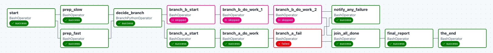
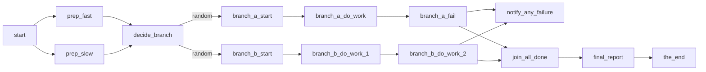
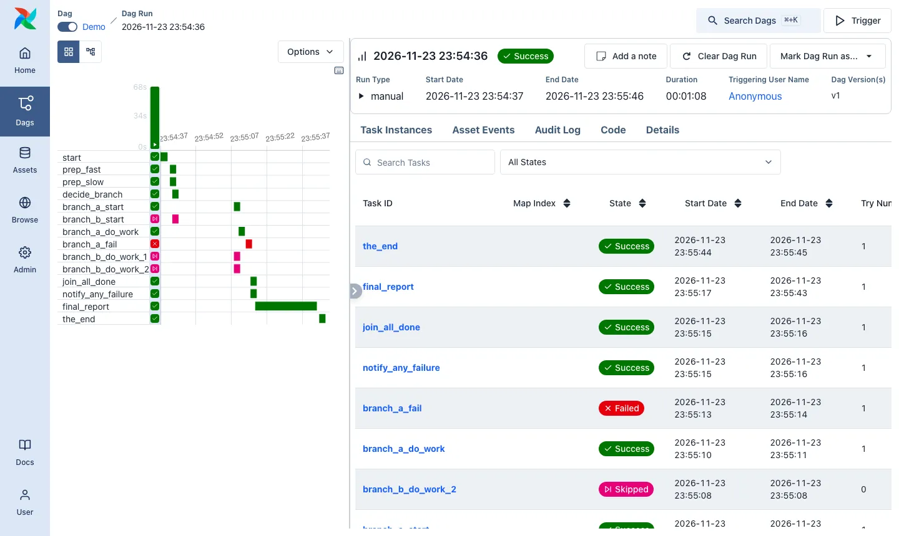
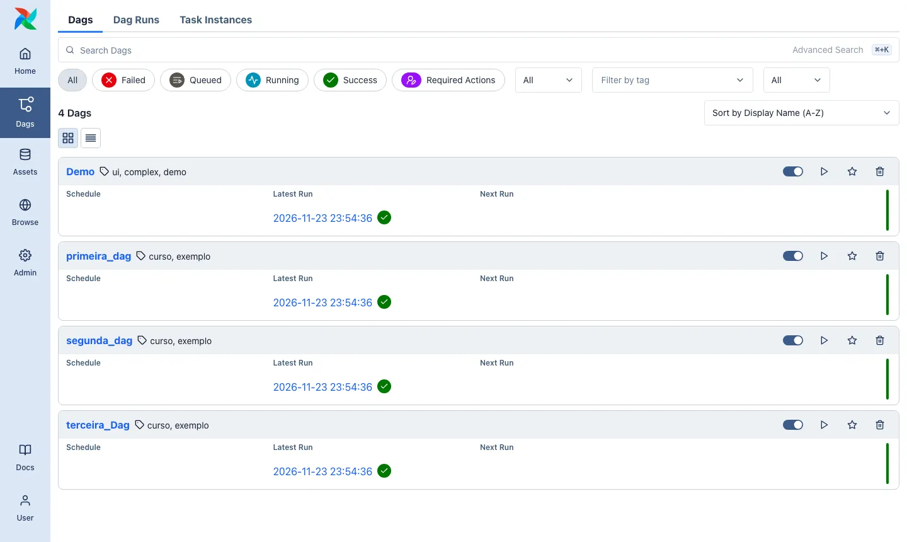

# airflow-dags-study

Apache Airflow 3.1 study project: four DAGs that go from a plain sequential chain to branching with trigger rules, running on the official Docker Compose stack (CeleryExecutor, PostgreSQL, Redis). The `curso` tag on the first three DAGs marks them as course exercises.



## DAGs

All DAGs have `schedule=None` (manual trigger only) and `catchup=False`.

| File | DAG ID | Tasks | Concept |
|---|---|---|---|
| `dags/1.PrimeiraDag.py` | `primeira_dag` | `tsk1 >> bash_task >> tsk3 >> tsk4 >> tsk5` | Sequential chain of `BashOperator`s |
| `dags/2.segundaDag.py` | `segunda_dag` | `tsk1 >> [bash_task, tsk3] >> tsk4` | Fan-out / fan-in |
| `dags/3.TerceiraDag.py` | `terceira_Dag` | `[tsk1, bash_task] >> tsk3 >> tsk4` | Two independent upstreams joining |
| `dags/demo.py` | `Demo` | 14 tasks, see below | Branching and trigger rules |

The tasks only run shell commands (`sleep 5`, `echo`, `ls`, `pwd && ls -la`), so the point is the dependency graph, not the work.

### The `Demo` DAG



- `decide_branch` is a `BranchPythonOperator` that returns `branch_a_start` or `branch_b_start` with `random.choice`; the other branch is marked **skipped**.
- `branch_a_fail` ends with `exit 1` and `retries=0`, so branch A always fails.
- `notify_any_failure` uses `TriggerRule.ONE_FAILED`: it runs only when branch A was chosen.
- `join_all_done` uses `TriggerRule.ALL_DONE`: it runs whatever the upstream state (success, failed or skipped).
- `final_report` uses `TriggerRule.ALL_DONE_MIN_ONE_SUCCESS`, and `the_end` keeps the default `ALL_SUCCESS`.

Because the leaf task `the_end` succeeds, the DAG run ends as **success** even when branch A failed:



## Stack

- Apache Airflow 3.1.0 (`apache/airflow:3.1.0`), CeleryExecutor, FAB auth manager
- PostgreSQL 16 (metadata database)
- Redis 7.2 (Celery broker)
- Docker Compose (based on the official Airflow `docker-compose.yaml`)

Services: `airflow-apiserver` (UI and REST API on port 8080), `airflow-scheduler`, `airflow-dag-processor`, `airflow-worker`, `airflow-triggerer` and the one-shot `airflow-init`, plus `airflow-cli` (profile `debug`) and `flower` (profile `flower`).

## Getting started

### Prerequisites

- Docker with Docker Compose v2
- At least 4 GB RAM and 2 CPUs for Docker (`airflow-init` checks this)

### Run

```bash
# 1. Linux only: run the containers with your user ID so logs/ stays writable
echo "AIRFLOW_UID=$(id -u)" > .env

# 2. Migrate the metadata DB and create the admin user
docker compose up airflow-init

# 3. Start everything
docker compose up -d
```

Open http://localhost:8080 and log in with `airflow` / `airflow` (created by `airflow-init`; override with `_AIRFLOW_WWW_USER_USERNAME` and `_AIRFLOW_WWW_USER_PASSWORD`). New DAGs start paused (`DAGS_ARE_PAUSED_AT_CREATION`): unpause one and press **Trigger**.



Useful extras:

```bash
docker compose exec airflow-scheduler airflow dags list   # CLI inside the stack
docker compose --profile flower up -d                     # Celery monitor on http://localhost:5555
```

### Stop

```bash
docker compose down             # keep the database
docker compose down --volumes   # also wipe the database
```

## Project structure

```
.
├── dags/                 # DAG files, mounted at /opt/airflow/dags
├── config/airflow.cfg    # mounted at /opt/airflow/config (AIRFLOW_CONFIG)
├── logs/                 # task and DAG processor logs written by the containers
├── docs/media/           # README images
└── docker-compose.yaml
```

`plugins/` is not in the repo; `airflow-init` creates it on the first run.

## Known limitations

- `1.PrimeiraDag.py`, `2.segundaDag.py` and `3.TerceiraDag.py` import `airflow.operators.bash`, which Airflow 3 still accepts with a `DeprecatedImportWarning`; `demo.py` imports the deprecated `airflow.utils.trigger_rule`. The current paths are `airflow.providers.standard.operators.bash` and `airflow.task.trigger_rule`.
- `config/airflow.cfg` says `executor = LocalExecutor`, `SimpleAuthManager` and `load_examples = True`, but the environment variables in `docker-compose.yaml` override all three. Change these settings in the compose file, not in the `.cfg`.
- `config/airflow.cfg` is a generated file with local `fernet_key`, `secret_key` and `jwt_secret` values. Fine for a local study setup; regenerate them before using it anywhere else.
- `logs/`, `dags/__pycache__/` and `.env` are committed from past local runs.
- The `demo.py` comments contain leftover `:contentReference[...]` citation markers.
- The README states MIT, but there is no `LICENSE` file in the repo.

## License

MIT © [Pedro Szpak](https://github.com/PeSzpak)
